<div align="center">

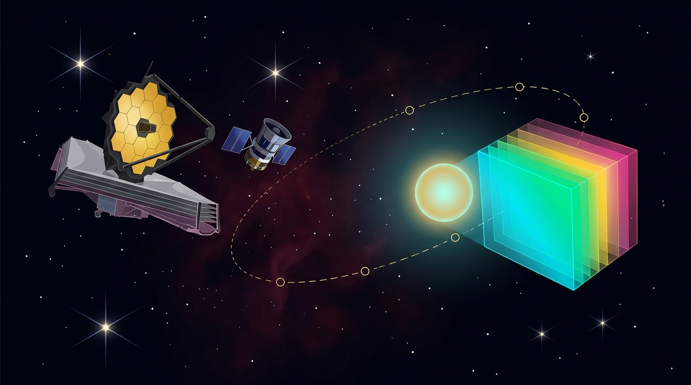

# Space-Max 0: Orbital Intelligence Engine

**Multi-Spectral Infrared Discovery Workbench for NASA SPHEREx, WISE, 2MASS, ESA Gaia DR3 & Citizen Science RLHF**

[](https://react.dev/)
[](https://www.typescriptlang.org/)
[](https://threejs.org/)
[](https://tailwindcss.com/)
[](https://fastapi.tiangolo.com/)
[](https://pytorch.org/)
[](https://ai.google.dev/)
[](./LICENSE)

[Mission Overview](#-mission-overview) • [Architecture](#-system-architecture) • [3-Step Observatory](#-three-step-observatory-workflow) • [Target Presets](#-built-in-nasa--spherex-target-presets) • [API Reference](#-api-reference) • [Quick Start](#-quick-start--deployment)

</div>

---

## 🔭 Mission Overview

Cold substellar worlds—such as **Y-Dwarfs**, **T-Dwarfs**, and distant **Planet X** candidates—emit almost no visible light, rendering them invisible to traditional optical telescopes. **Space-Max 0** turns raw multi-epoch infrared FITS data and 102-band spectrophotometry into an interactive mission-control observatory where astrophysicists, NASA Space Apps judges, and citizen scientists can hunt for uncatalogued moving objects in real time.

### What Space-Max 0 Solves

1. **Multi-Epoch Blinking & Astrometry:** Streams historical near-IR (`2MASS K`, ~2000) through modern thermal-IR (`WISE/AllWISE W2` & `SPHEREx QR2/QR3`, 2026) cutouts, aligns WCS frames, and highlights sub-pixel proper motion (`mas/yr`) with an interactive golden kinematic vector overlay.
2. **Hyperspectral 3D Light Cubes:** Slices a `32 × 32 × 102` hyperspectral infrared cube (`0.75–5.0 µm`) in WebGL alongside a live 102-band absorption spectrometer sensitive to `H₂O` (`1.4 / 1.9 µm`), `CH₄` (`2.3 / 3.3 µm`), and `CO` (`4.6 µm`).
3. **Tri-Model PyTorch + Multi-Agency Vetting:** Combines a **2D-CNN** (cosmic-ray & artifact rejection), **BiGRU Spectral RNN** (102-band chemical classification), and **Gaia DR3 Kinematic GNN** with **CSA NEOSSat / CADC** and **IMCCE SkyBoT** known-asteroid crossmatching—plus live **RLHF PyTorch backward passes** persisted to SQLite.

<div align="center">
  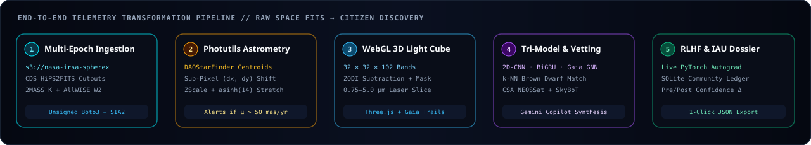
</div>

---

## 🛰️ Three-Step Observatory Workflow

<div align="center">
  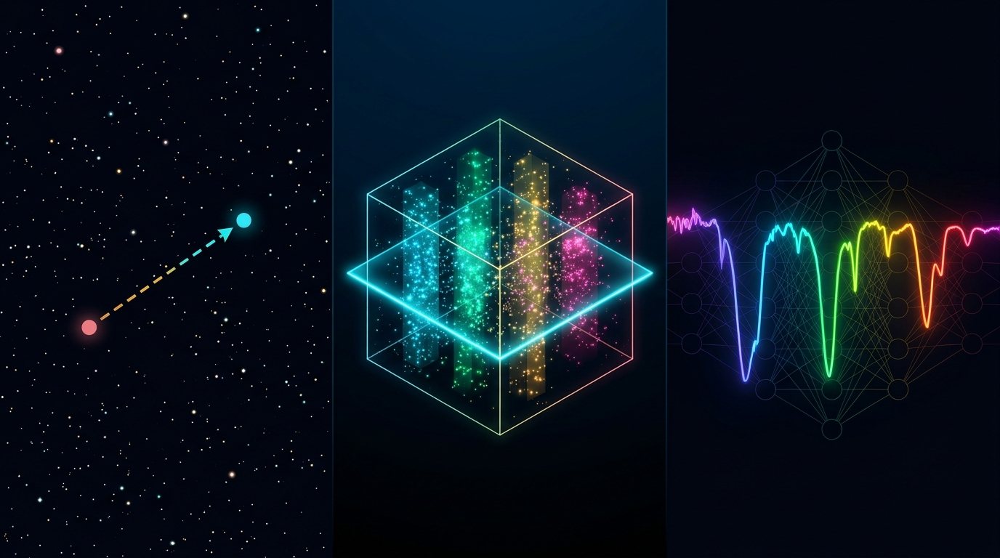
</div>

| Step | Module | Core Capabilities | Key Telemetry & Controls |
| :--- | :--- | :--- | :--- |
| **Step 01** | **Blink & Kinematics**<br>`SkyViewport` · `BlinkComparator` · `KinematicVectorOverlay` · `AladinSkyMap` | • 6-epoch time-lapse playback (`2000.4` → `2026.8`)<br>• **ZScale + `asinh(14)`** & false-color IR stretch<br>• Interactive dashed-gold proper motion vector + tooltip<br>• Automatic **`Transient Alert`** badge when `μ > 50 mas/yr`<br>• Integrated Aladin/HiPS sky view & Camera Stack Drawer | `CRVAL1/2`, `CDELT1/2`, `BUNIT`, Background RMS `σ`, Peak SNR, Displacement (`arcsec`), Proper Motion (`mas/yr`) |
| **Step 02** | **3D Light Cube & Rainbow Fingerprint**<br>`WebGLDataCube3D` · `SpectralChart` | • Interactive Three.js `32×32×102` volumetric cube<br>• **2D Cross-Section Slice** synced with live `µm` laser plane<br>• 3D **Gaia Star-Field** `TubeGeometry` kinematic trails<br>• Recharts 102-band curve with `H₂O`, `CH₄`, `CO` markers<br>• `ZODI` zodiacal background subtraction & `BLANKCH` `51–52` gap mask | Wavelength (`0.75–5.0 µm`), Band `1–102`, Flux (`µJy`), SPHEREx dichroic split (`~2.42 µm`), k-NN spectral template |
| **Step 03** | **Tri-Model AI, Gemini Guide & RLHF**<br>`DiagnosticsCopilotPanel` · `GeminiMissionChat` | • PyTorch **2D-CNN + BiGRU RNN + Gaia GNN** triad<br>• CSA NEOSSat / CADC & IMCCE SkyBoT asteroid vetting<br>• Multi-turn **Gemini Space Guide** (3 roles × 3 thinking modes)<br>• Citizen-science **RLHF voting** with live `loss` & weight delta<br>• One-click **NASA/IAU Discovery Dossier** JSON export | `Planet X %`, `Brown Dwarf %`, `Artifact %`, SQLite RLHF ledger, Live `/ws/telemetry` stream |

### Instrument & AI Module Suite (`docs/assets/icons/`)

<table>
  <tr>
    <td align="center" width="16.6%">
      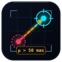<br />
      <strong>Blink &amp; Kinematics</strong><br />
      <sub><code>KinematicVectorOverlay</code></sub>
    </td>
    <td align="center" width="16.6%">
      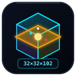<br />
      <strong>WebGL 3D Cube</strong><br />
      <sub><code>WebGLDataCube3D</code></sub>
    </td>
    <td align="center" width="16.6%">
      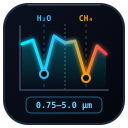<br />
      <strong>102-Band IR</strong><br />
      <sub><code>SpectralChart</code></sub>
    </td>
    <td align="center" width="16.6%">
      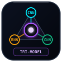<br />
      <strong>Tri-Model AI</strong><br />
      <sub><code>ml_pipeline.py</code></sub>
    </td>
    <td align="center" width="16.6%">
      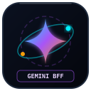<br />
      <strong>Gemini Copilot</strong><br />
      <sub><code>GeminiMissionChat</code></sub>
    </td>
    <td align="center" width="16.6%">
      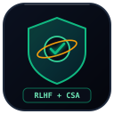<br />
      <strong>RLHF &amp; Vetting</strong><br />
      <sub><code>DiagnosticsCopilotPanel</code></sub>
    </td>
  </tr>
</table>

---

## 🏗️ System Architecture

Space-Max 0 pairs a high-contrast **React 19 + Three.js WebGL** observatory UI served by a lightweight **Express BFF** (port `3000`, protecting `GEMINI_API_KEY` server-side for the **Gemini AI Copilot**) with a cloud-hosted **FastAPI + PyTorch + Astropy SPHEREx data pipeline** (`https://space-max-0-backend.onrender.com`).

<div align="center">
  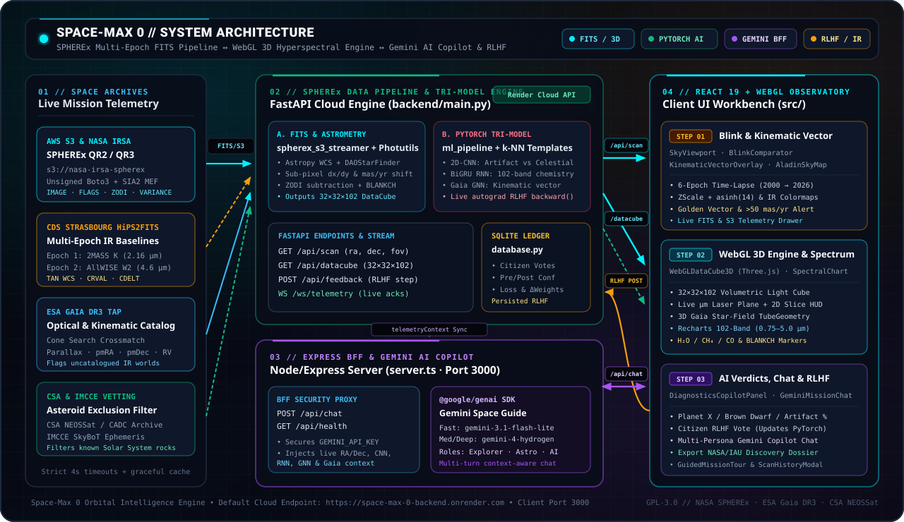
</div>

<details>
<summary><b>View Interactive Mermaid Topology &amp; RLHF Sequence Diagrams</b></summary>

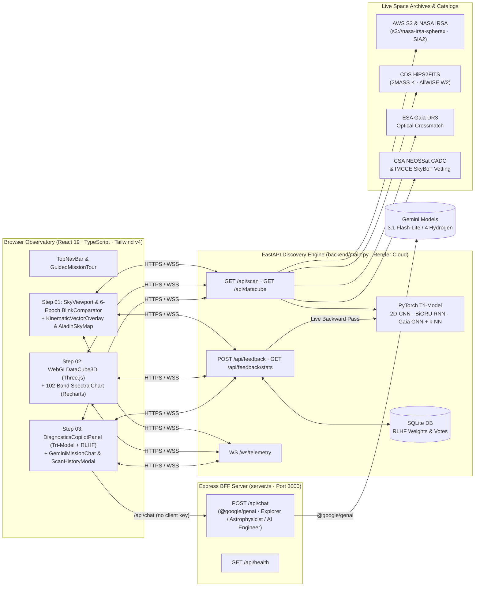

### Real-Time Discovery & Citizen-Science RLHF Loop

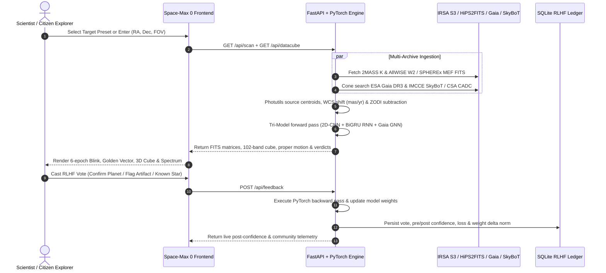

</details>

---

## 🌟 Built-In NASA / SPHEREx Target Presets

Space-Max 0 includes **6 calibrated sky targets** ready for one-click exploration alongside arbitrary `RA / Dec` sky coordinate scans (`3'`, `15'`, or `1°` FOV):

| Target | Coordinates (`RA`, `Dec`) | Spectral Fingerprint | Proper Motion (`pmRA / pmDec`) | Discovery Highlight |
| :--- | :--- | :--- | :--- | :--- |
| **SPHEREx QR2 Candidate** | `166.33243°`, `+29.94057°` | `Brown Dwarf • H₂O + CH₄` | `+14.2 / -6.8 mas/yr` | Uncatalogued in Gaia DR3; Planet X / cold brown dwarf candidate (`~41.5 km/s`) |
| **WISE 0855** | `133.80020°`, `-7.24580°` | `Y-Dwarf • H₂O + CH₄ + CO` | `-8118.0 / +680.0 mas/yr` | Coldest known failed star (`~250 K`) at `7.4 ly` with water-ice clouds |
| **Barnard's Star** | `269.45208°`, `+4.69339°` | `M4V Red Dwarf • Silicate + H₂O` | `-801.55 / +10362.39 mas/yr` | Fastest-moving star in Earth's sky; calibrated Gaia DR3 kinematic benchmark |
| **Epsilon Indi B** | `330.84020°`, `-56.78600°` | `T1/T6 Binary • CH₄ + H₂O` | `+3960.9 / -2536.2 mas/yr` | Binary brown dwarf pair `12 ly` away showing sharp water & methane dips |
| **RW Aurigae** | `76.95650°`, `+30.40140°` | `T Tauri Disk • CO + Silicate` | `+4.8 / -22.1 mas/yr` | Young circumstellar planet-forming dust disk glowing in mid-IR |
| **R Draconis** | `248.16200°`, `+66.75100°` | `Mira Variable • H₂O + CO` | `-2.4 / +11.7 mas/yr` | Long-period pulsating giant star rich in hot steam & carbon monoxide |

---

## 📡 API Reference

### Express BFF Server (`server.ts` · Port `3000`)

| Method & Path | Purpose | Notes |
| :--- | :--- | :--- |
| `GET /api/health` | BFF & Gemini key readiness check | Returns `{ status: "ok", geminiConfigured: boolean }` |
| `POST /api/chat` | Context-aware Gemini Space Guide | Accepts `message`, `history`, `role` (`explorer` \| `astrophysicist` \| `analyst`), `modelMode` (`fast` → `gemini-3.1-flash-lite`, `balanced` / `deep` → `gemini-4-hydrogen`), and live `telemetryContext` |

### Python FastAPI Engine (`backend/main.py` · Default Cloud URL: `https://space-max-0-backend.onrender.com`)

| Method & Path | Purpose | Key Query / Body Parameters |
| :--- | :--- | :--- |
| `GET /health` | Service health & active PyTorch version | Returns `status`, `service`, `model_version` |
| `GET /api/scan` | Full multi-epoch ingestion, astrometry & Tri-Model scan | `ra`, `dec`, `fov`, `live_gaia`, `live_skyview` |
| `GET /api/datacube` | Extract `32×32×102` hyperspectral cube & flux vector | `ra`, `dec`, `fov`, `x_pos`, `y_pos` |
| `POST /api/feedback` | Trigger real PyTorch RLHF backward pass & log vote | `ra`, `dec`, `user_vote`, `target_name`, optional `epoch1`, `epoch2`, `spectrum` |
| `GET /api/feedback/stats` | Fetch aggregate SQLite RLHF votes & recent ledger | `model_version` |
| `WS /ws/telemetry` | Bi-directional live telemetry & scan-stage stream | `ping` / `subscribe` / `scan_initiated` JSON messages |

---

## 📁 Project Structure

```text
space-max-0/
├── docs/
│   └── assets/
│       ├── hero-banner.jpg              # README hero visual
│       ├── tri-step-observatory.jpg     # 3-step visual showcase
│       ├── system-architecture.svg      # End-to-end SPHEREx / WebGL / Gemini diagram
│       ├── spherex-dataflow-banner.svg  # 5-stage FITS-to-Discovery pipeline graphic
│       └── icons/
│           ├── icon-blink-kinematics.svg
│           ├── icon-webgl-datacube.svg
│           ├── icon-spectral-102.svg
│           ├── icon-trimodel-ai.svg
│           ├── icon-gemini-copilot.svg
│           └── icon-rlhf-vetting.svg
├── src/
│   ├── App.tsx                          # 3-column bento observatory shell & scan orchestrator
│   ├── index.css                        # Deep Cosmic Void theme, glassmorphism & Tailwind v4
│   ├── main.tsx                         # React 19 entry point
│   ├── components/
│   │   ├── TopNavBar.tsx                # RA/Dec coordinate bar, FOV selector & 6 NASA presets
│   │   ├── SkyViewport.tsx              # Unified Step 01 viewport & FITS/S3 telemetry drawer
│   │   ├── BlinkComparator.tsx          # 6-epoch time-lapse player, ZScale/asinh & difference view
│   │   ├── KinematicVectorOverlay.tsx   # Dashed-gold SVG proper motion vector & >50 mas/yr alert
│   │   ├── AladinSkyMap.tsx             # Interactive Aladin / HiPS deep-sky survey map
│   │   ├── WebGLDataCube3D.tsx          # Three.js 3D hyperspectral cube, 2D slice & Gaia trails
│   │   ├── SpectralChart.tsx            # Recharts 102-band spectrometer (0.75–5.0 µm)
│   │   ├── DiagnosticsCopilotPanel.tsx  # Tri-Model verdicts, CSA vetting, RLHF & Dossier export
│   │   ├── GeminiMissionChat.tsx        # Multi-persona Gemini Space Guide drawer/modal
│   │   ├── GuidedMissionTour.tsx        # Interactive walkthrough for judges & explorers
│   │   └── ScanHistoryModal.tsx         # Saved coordinate scan history modal
│   ├── data/
│   │   └── presetsAndFallback.ts        # 6 calibrated NASA/SPHEREx target presets & offline matrices
│   ├── types/
│   │   └── telemetry.ts                 # TypeScript interfaces for FITS, cubes, AI & RLHF
│   └── utils/
│       └── astroStretch.ts              # ZScale, asinh(14), heat & false-color IR colormaps
├── backend/
│   ├── main.py                          # FastAPI routes, RLHF feedback endpoint & WebSocket
│   ├── database.py                      # SQLite persistence for scans & RLHF weights
│   ├── Dockerfile                       # Container build for Render / Cloud Run deployment
│   ├── requirements.txt                 # FastAPI, PyTorch, Astropy, Photutils, Boto3, Astroquery
│   ├── server/
│   │   ├── aws_ingestion.py             # Multi-epoch archive & SPHEREx ingestion helpers
│   │   ├── cnn_model.py                 # PyTorch 2D-CNN artifact vs celestial classifier
│   │   ├── rnn_spectrum.py              # PyTorch BiGRU 102-band spectral classifier
│   │   ├── gnn_kinematic.py             # Gaia Star-Field GNN kinematic analyzer
│   │   ├── gaia_crossmatch.py           # ESA Gaia DR3 cone search crossmatching
│   │   ├── spherex_pipeline.py          # Orchestrated scan & 3D datacube pipeline
│   │   ├── timemachine_skyview.py       # NASA SkyView / HiPS multi-epoch cutout streamer
│   │   ├── gemini_copilot.py            # Server-side diagnostic synthesis helpers
│   │   └── models.py                    # Shared backend Pydantic/data models
│   └── services/
│       ├── spherex_s3_streamer.py       # Unsigned boto3 s3://nasa-irsa-spherex & IRSA SIA2 client
│       ├── astro_streamer.py            # HiPS2FITS cutout fetcher & Photutils centroiding
│       ├── ml_pipeline.py               # Tri-Model PyTorch inference & live RLHF fine-tuning
│       ├── cadc_neossat_filter.py       # CSA NEOSSat CADC ephemeris & Solar System filtering
│       └── partner_vetting.py           # IMCCE SkyBoT & partner observatory vetting
├── server.ts                            # Express + Vite dev middleware & Gemini /api/chat proxy
├── package.json                         # Node/React dependencies & scripts
├── .env.example                         # Environment variable template
└── LICENSE                              # GNU General Public License v3.0
```

---

## 🚀 Quick Start & Deployment

### Prerequisites

- **Node.js `>= 20`** (for the React + Express observatory)
- **Python `>= 3.10`** (optional locally—the frontend automatically defaults to the live cloud engine at `https://space-max-0-backend.onrender.com` unless `VITE_PYTHON_API_URL` is overridden)

### 1. Run the Observatory Frontend & Express BFF

```bash
# Install frontend & BFF dependencies
npm install

# Configure environment variables (copy .env.example to .env and add your Gemini key)
cp .env.example .env

# Start the Express + Vite development server on http://localhost:3000
npm run dev
```

#### Environment Variables

| Variable | Scope | Required | Description |
| :--- | :--- | :--- | :--- |
| `GEMINI_API_KEY` | Express BFF (`server.ts`) | For Space Guide chat | Google Gemini API key injected server-side (`Settings > Secrets` or `.env`) |
| `APP_URL` | Express BFF (`server.ts`) | Optional | Public deployment URL for self-referential links |
| `VITE_PYTHON_API_URL` | Vite Client (`src/`) | Optional | Overrides the default Render FastAPI backend (`https://space-max-0-backend.onrender.com`) |

### 2. Production Build & Start (Port `3000`)

```bash
# Type-check and build the production bundle into dist/
npm run lint
npm run build

# Run the production Express server
NODE_ENV=production npm start
```

### 3. Run the Python FastAPI Discovery Engine Locally (Optional)

```bash
cd backend
pip install -r requirements.txt
uvicorn main:app --host 0.0.0.0 --port 8000 --reload
```

Or build with the included container definition:

```bash
docker build -t space-max-0-backend ./backend
docker run -p 8000:8000 space-max-0-backend
```

Point the frontend to your local FastAPI instance by setting `VITE_PYTHON_API_URL=http://localhost:8000` in `.env`.

---

## 📄 License

Distributed under the **GNU General Public License v3.0 (GPL-3.0)**. See [`LICENSE`](./LICENSE) for full terms.
